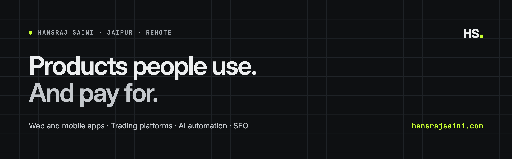

# Hansraj Saini · HS

**You built it with AI. I make it ready for real users.**

I'm a product engineer in Jaipur, India, and I run [HS](https://hansrajsaini.com), a one-person product studio. I fix apps built with **Lovable, Bolt, Cursor and v0**: code audits, security fixes, clean-up, SEO and launch. I also design and build new **web and mobile apps** in Next.js and React Native, for founders in the US, UK and Europe.

[Website](https://hansrajsaini.com) · [Services and prices](https://hansrajsaini.com/services) · [Work](https://hansrajsaini.com/work) · [Send a brief](https://hansrajsaini.com/contact) · [LinkedIn](https://www.linkedin.com/in/hansrajsaini8149/) · [X](https://x.com/Hansraj32323520)

## What I do

- **Code audit for AI-built apps.** A written report on what's broken, what's risky and what to fix first, ranked by risk, at a fixed price.
- **Security fixes.** Supabase RLS policies, exposed API keys, missing auth checks, payments that aren't verified on the server.
- **Code clean-up.** TypeScript, tests and repeatable deploys, so the next developer (or your AI tool) can change it without breaking it.
- **New web and mobile products.** Designed and built by one person, from the first screen to the App Store and Google Play.
- **SEO and speed.** Pages Google can index, Core Web Vitals, analytics.
- **AI automation.** Agents and workflows with logs and cost tracking (Mastra, Temporal).

## Shipped work

| Product | What it is | Live |
| --- | --- | --- |
| [Unlok mobile](https://hansrajsaini.com/work/unlok-mobile) | React Native trading app for US stocks and ETFs, built from an empty repo as the only mobile engineer | App Store and Google Play |
| [Unlok web](https://hansrajsaini.com/work/unlok-web) | Trading platform: screener, quotes, order ticket, alerts | [app.unlok.com](https://app.unlok.com) |
| [Unlok Insights](https://hansrajsaini.com/work/unlok-insights) | AI-written market briefs: 16 agents in production and a newsroom-style CMS. I led it. | [insights.unlok.com](https://insights.unlok.com) |
| [Flyku](https://hansrajsaini.com/work/flyku) | Find running clubs and group runs across the US | Web and Google Play |
| [Cab in Jaipur](https://hansrajsaini.com/work/cab-in-jaipur) | Static site with its own CMS: 74 pages the owners publish themselves | [cabinjaipur.com](https://cabinjaipur.com) |
| [Yoga with Latu](https://hansrajsaini.com/work/yoga-with-latu) | Trilingual site that turns visitors into WhatsApp free-trial chats | [yogawithlatu.in](https://yogawithlatu.in) |

## Writing

- [Is your Lovable app secure? A Supabase security checklist](https://hansrajsaini.com/journal/lovable-supabase-security-checklist)
- [API keys in your front end: how to find them and fix them](https://hansrajsaini.com/journal/api-keys-exposed-in-frontend)
- [Why Google can't see your AI-built site, and how to fix it](https://hansrajsaini.com/journal/lovable-app-seo-google-not-indexing)
- [Should you fix your AI-built app or rewrite it?](https://hansrajsaini.com/journal/fix-or-rewrite-ai-built-app)
- [How much does a code audit cost for an AI-built app?](https://hansrajsaini.com/journal/code-audit-cost)
- [Taking Temporal from a POC to company-wide](https://hansrajsaini.com/journal/temporal-from-poc-to-company-wide)

## Background

Since 2024 I've worked on fintech products for a US team: the Unlok trading app for iOS and Android, a corporate actions engine (dividends, splits, delistings), a reconciliation system that checks every account against exchange records, real-time notifications over Apache Pulsar, and Temporal workflows taken from proof of concept to company-wide use. Before that I interned at PathCreators. B.Tech in Computer Science.

**Stack:** TypeScript · Next.js · React · React Native · Expo · Flutter · Supabase · Firebase · PostgreSQL · Express · Temporal · Mastra · Cloudflare Workers · AWS · Docker · GitHub Actions

## Work with me

Free 30-minute intro call. Every quote is fixed before I start. I take calls 7am to midnight India time (UTC+5:30), which covers the UK and European day and US mornings.

**[Send a brief at hansrajsaini.com/contact](https://hansrajsaini.com/contact)** or email hansrajwork8149@gmail.com.
